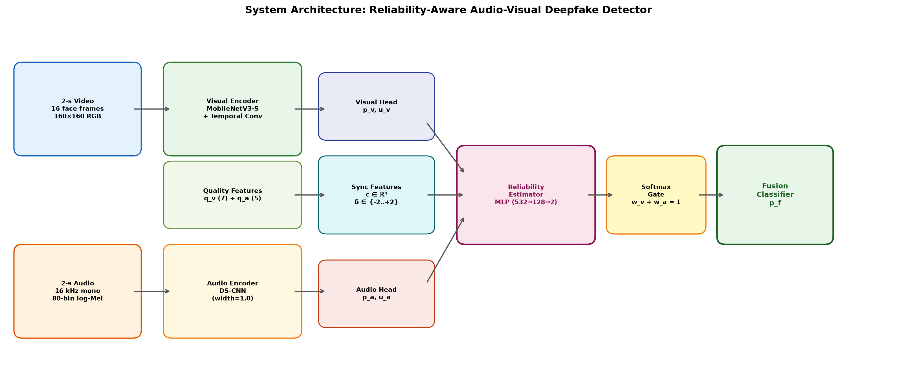
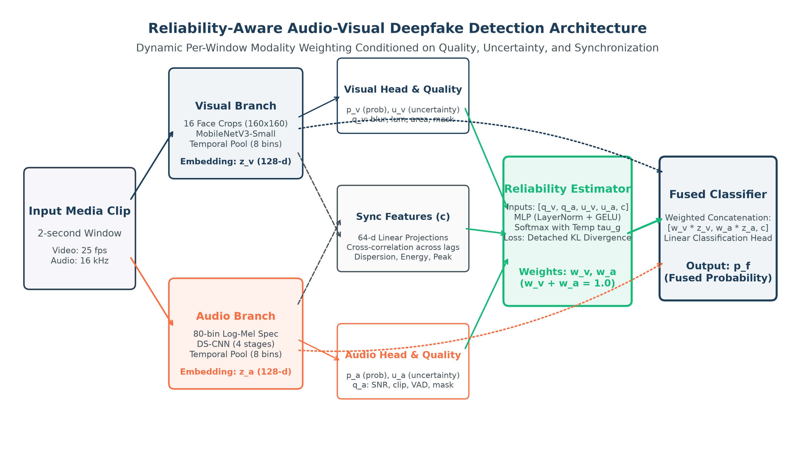
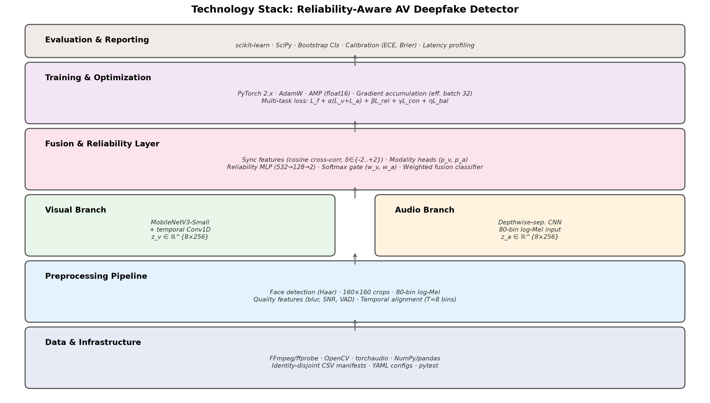
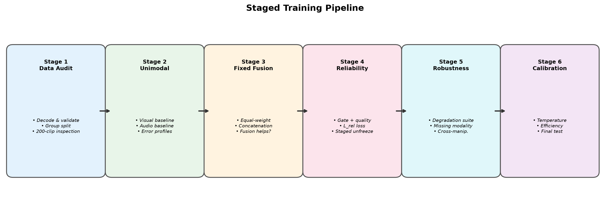
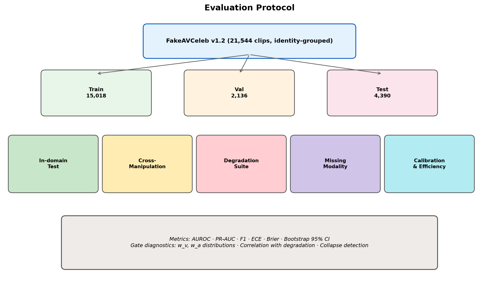
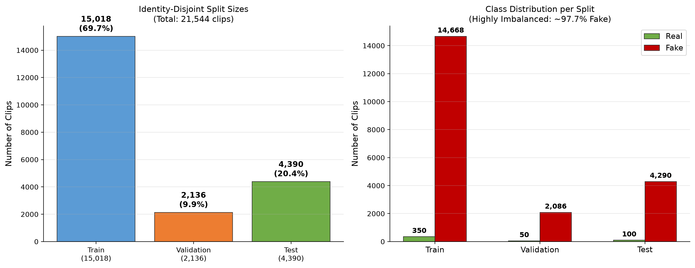
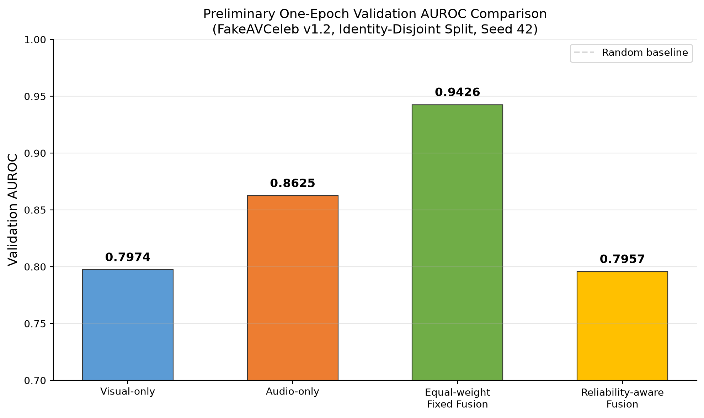
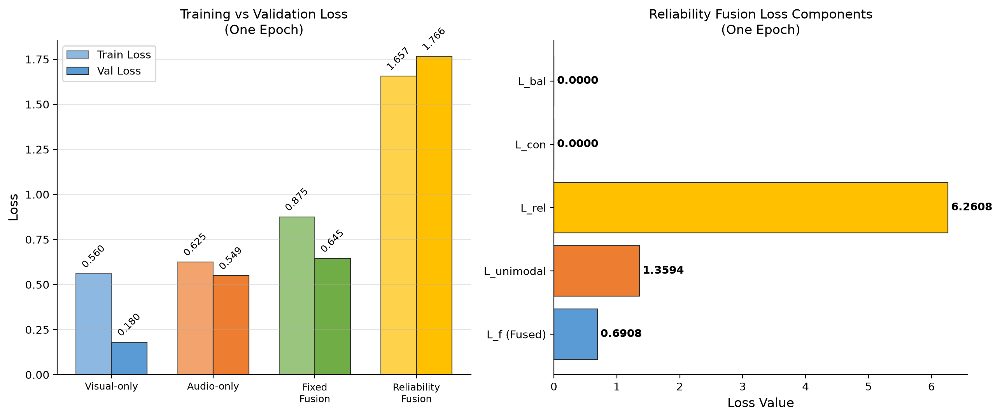

# PBL-2 PROJECT REPORT

**Cross-Manipulation Generalizable Audio-Visual Deepfake Detection via Reliability-Aware Lightweight Fusion**

---

| | |
|---|---|
| **Course** | Report Writing (21CSC402P) |
| **Department** | Department of Computing Technologies |
| **Institution** | SRM Institute of Science and Technology, Kattankulathur, Chennai |
| **Assessment Date** | 16 October 2026 |
| **Assessment** | PBL-2 (20 Marks) |

| Team Member | Register Number |
|---|---|
| Aditya Sahu | RA2311026010814 |
| Akash Cherian | RA2311026010852 |
| Prachurya Subhasmita | RA2311026010855 |

**Status:** Preliminary implementation with one-epoch validation runs. Results in Section 9 are validation-only snapshots; no final test metrics are reported.

---

## Abstract

Audio-visual deepfakes may alter a face, a voice, or both. A detector that simply concatenates audio and visual features assumes that both streams deserve comparable trust. That assumption is weak when video is compressed, the face crop fails, the audio is noisy, or a manipulation leaves only one stream informative. Earlier work has shown that audio-visual inconsistency, affective mismatch and cross-modal representations are useful, and newer work also reports dynamic weighting strategies [1–6].

This project proposes a small, reproducible detector that extracts aligned face-motion and speech-spectrogram features, estimates per-window modality reliability, and fuses the two streams using learned weights. Synchronisation is retained only as an auxiliary reliability signal, not as the headline claim: a well-synchronised fake can still be fake, and a real video can be imperfectly synchronised. The system will be judged against unimodal and conventional-fusion baselines under identity-disjoint, manipulation-held-out and controlled degradation protocols.

The initial scope uses short 2-second clips, cached face crops and log-Mel spectrograms, compact encoders, mixed precision and a single modest GPU. The intended contribution is evidence on whether reliability-aware lightweight fusion improves the accuracy–robustness–latency trade-off under a clearly specified protocol. At the PBL-2 stage, saved histories contain one validation epoch for four model variants. Preliminary values: Visual-only AUROC **0.7974**, Audio-only **0.8625**, Equal-weight fusion **0.9426**, Reliability-aware fusion **0.7957**. These are not final test results or evidence that the hypotheses are supported.

---

## 1. Introduction

### 1.1 Background

Deepfake detection is a binary media-authenticity task: given a video clip with audio, estimate whether the clip has been manipulated. Visual evidence can include face texture, blending artefacts and motion. Audio evidence can include synthesis or voice-conversion artefacts and temporal speech structure. Cross-modal evidence can include correspondence between mouth motion, speech timing and broader affective cues. Chugh et al. used audio-visual dissonance [1], Mittal et al. used affective agreement [2], and AVoiD-DF and AVFF model joint audio-visual evidence [3, 4].

### 1.2 Problem Statement

Given an audio-video sample x = (V, A), predict y ∈ {0, 1}, where 0 is real and 1 is fake. Standard fusion computes the prediction as:

> ŷ = f( E_v(V), E_a(A) )

The central problem is that the usefulness of V and A is **instance dependent**:
- Video may be low resolution, blurred, re-encoded, occluded, or have failed face detection
- Audio may be silent, noisy, clipped, off-screen, or not actually manipulated
- A synthetic clip may be temporally consistent, so a synchronisation-only detector can fail
- A model can memorise generator-specific or identity-specific artefacts instead of learning transferable evidence

**Proposed formulation:** Design a compact detector that estimates the relative reliability of visual and audio evidence for each short window, uses it in fusion, and tests whether this improves performance over fixed or naïve fusion when manipulation family, identity, codec and quality change.

### 1.3 Motivation and Research Gaps

| Gap | Evidence from Prior Work | Project Response |
|---|---|---|
| Fusion is not automatically better than unimodal detection | Muppalla, Jia and Lyu motivate integration because audio-visual methods do not always exceed unimodal analysis [5]. | Compare visual-only, audio-only, fixed fusion and reliability-aware fusion; report when fusion loses. |
| Cross-manipulation transfer is difficult | AVoiD-DF studies joint learning and inconsistency, motivating manipulation-aware testing [3]. | Hold out manipulation categories or generators before training. |
| Cross-modal correspondence is useful but insufficient alone | Dissonance, affective cues and AVFF exploit correspondence [1, 2, 4]. | Feed synchronisation to the gate and classifier as a feature, while keeping independent forensic features. |
| Dynamic weighting already exists | AVT²-DWF proposes dynamic weight fusion [6]. | Do not claim first use. Narrow novelty to a transparent, reliability-targeted lightweight design and its evaluation protocol. |
| Clean-benchmark scores do not show deployment robustness | Compression and domain shift change forensic cues. | Use controlled codec and noise tests; report latency, calibration and failure cases. |

*Table 1. Research gaps and the project's response.*

### 1.4 Objectives and Success Criteria

1. Build a reproducible aligned audio-visual pipeline with provenance manifests and source-identity grouping.
2. Implement compact audio, visual, fixed-fusion, synchronisation-augmented and reliability-aware models.
3. Evaluate in-domain, cross-manipulation, cross-dataset (where valid) and degradation settings.
4. Report discrimination, calibration, uncertainty, efficiency and quality breakdowns with confidence intervals.
5. Release code, configuration and split manifests only as far as dataset terms allow; never redistribute restricted videos.

---

## 2. Literature Survey

| Work | Established Contribution | Relation / Limitation for This Project |
|---|---|---|
| Chugh et al., ACM MM 2020 [1] | Learns modality dissonance; reports temporal localisation. | Shows mismatch is useful; mismatch alone can miss synchronised fakes. |
| Mittal et al., ACM MM 2020 [2] | Audio-visual affective cues with a Siamese/triplet formulation. | Supports complementary cues; affect prediction adds cost and may be domain-sensitive. |
| Yang et al., IEEE TIFS 2023, AVoiD-DF [3] | Audio-visual joint learning based on inconsistency; DefakeAVMiT evaluation. | Strong reference for cross-manipulation evaluation; leakage controls are still needed. |
| Oorloff et al., CVPR 2024, AVFF [4] | Two-stage self-supervised cross-modal representation learning plus supervised fine-tuning. | Strong but likely heavier; published numbers are not comparable without the same split and protocol. |
| Muppalla et al., 2023 [5] | Integrates fine-grained unimodal labels with binary classification; notes multimodal does not always beat unimodal. | Justifies rigorous unimodal baselines. |
| Wang et al., 2024, AVT²-DWF [6] | Dual-transformer dynamic weight fusion. | Direct prior art for dynamic weights; an arXiv preprint unless a peer-reviewed version is verified. |
| Ilyas et al., 2023, AVFakeNet [7] | Dense Swin Transformer, end-to-end audio-visual detection. | Useful reference model but too heavy as a first single-GPU baseline. |
| Khalid et al., FakeAVCeleb [8] | Audio-video benchmark with synthesised audio/video combinations. | Primary multimodal dataset candidate; access and label structure need an audit. |
| Dolhansky et al., DFDC [9] | Large face-swap dataset with consented actors and several facial modification algorithms. | Useful for visual training/robustness; not to be treated as an audio-deepfake benchmark. |

*Table 2. Literature survey.*

**Identified gap:** The literature already supplies cross-modal consistency features and dynamic weighting. What is less clear for a small, reproducible system is (i) whether a gate fed by explicit quality, uncertainty and consistency signals helps when manipulation family, identity and quality shift together, and (ii) at what accuracy and latency cost.

---

## 3. Proposed Idea

### 3.1 Core Idea

Extract aligned face-motion and log-Mel features with two compact encoders. For every 2-second window, a small reliability estimator reads modality quality indicators, unimodal uncertainty and audio-visual consistency, and outputs normalised weights (w_v, w_a). The fusion classifier then uses the weighted embeddings, the synchronisation features and the weights themselves to decide real versus fake.

### 3.2 What "Reliability" Means Here

Reliability is the estimated usefulness of a modality for the label on this window under the training distribution. It is **not** a ground-truth measure of media quality, and it is **not** a measure of authenticity. A gate should lower a weight when its modality is missing, degraded or uncertain, but this behaviour is measured, not assumed.

### 3.3 Synchronisation Is Secondary Evidence

Synchronisation features influence the gate and the final classifier but **never** determine the label alone. This avoids the false premise "out of sync = fake": dubbed real clips, speaker turns, music and transmission delay can be misaligned, while advanced fakes can be well aligned.

### 3.4 Novelty Assessment

| Defensible Proposed Novelty | Explicitly Not Claimed |
|---|---|
| A reliability estimator whose inputs combine modality-quality indicators, unimodal uncertainty and cross-modal consistency. | First audio-visual deepfake detector. |
| A reliability-target loss tied to unimodal correctness under modality-specific augmentation. | First dynamic fusion method (see AVT²-DWF [6]). |
| A lightweight evaluation protocol that treats synchronisation as secondary evidence. | First cross-modal consistency method. State-of-the-art performance. |

*Table 3. Novelty boundary.*

---

## 4. System Architecture



*Figure 1. End-to-end architecture of the proposed reliability-aware audio-visual deepfake detector.*



*Figure 2. Detailed system architecture showing quality signals, synchronization features, and gating mechanism.*

The system processes a 2-second video+audio clip through parallel visual and audio branches. The visual branch extracts 16 face frames at 160×160 resolution and encodes them via MobileNetV3-Small with temporal Conv1D into z_v ∈ ℝ^{8×256}. The audio branch converts audio to 80-bin log-Mel spectrograms and processes them through a depthwise-separable CNN into z_a ∈ ℝ^{8×256}. Quality features (blur, luminance, VAD, SNR proxy) and synchronization cross-correlation features feed into a reliability MLP that outputs softmax-normalized gate weights (w_v, w_a). The weighted embeddings, sync features, and weights are concatenated and passed through a fusion classifier to produce the final prediction p_f.

---

## 5. Technology Stack



*Figure 3. Layered technology stack from data infrastructure through evaluation.*

| Layer / Subsystem | Technology | Purpose and Status |
|---|---|---|
| **Language & Configuration** | Python 3.11; YAML via PyYAML | Config-driven data, model, training and evaluation settings. **Implemented.** |
| **Video Decoding** | FFmpeg/ffprobe; OpenCV | 25 fps video decode, container audio extraction. **Implemented.** |
| **Face Detection** | OpenCV Haar cascade | Face crop extraction with 20% box expansion → 160×160 RGB. **Implemented** (baseline). |
| **Audio Processing** | torchaudio; NumPy | Mono 16 kHz resampling, 80-bin log-Mel (25ms/10ms). **Implemented.** |
| **Visual Encoder** | PyTorch/torchvision MobileNetV3-Small | ImageNet-pretrained backbone + depthwise temporal Conv1D. **Implemented.** |
| **Audio Encoder** | PyTorch DS-CNN | 2D depthwise-separable CNN, width multiplier 1.0. **Implemented.** |
| **Fusion & Reliability** | PyTorch MLP, softmax gate | Modality heads, projector, sync features, reliability MLP (532→128→2). **Implemented.** |
| **Training** | PyTorch AdamW, AMP, gradient accumulation | Mixed precision float16, effective batch 32. **Implemented.** |
| **Data Control** | NumPy/pandas; CSV manifests | Source table and versioned identity-disjoint split manifests. **Implemented.** |
| **Evaluation** | scikit-learn; SciPy | AUROC, PR-AUC, ECE, bootstrap CIs, Youden threshold. **Implemented.** |
| **Unit Testing** | pytest | 67 tests: split exclusivity, gate weights, deterministic decode. **Passing.** |
| **Proposed Extensions** | RetinaFace/MediaPipe; ONNX; INT8 quantization | Landmark alignment, runtime export, quantization. **Proposed, not implemented.** |

*Table 4. Implementation technologies and component status.*

### Training Configuration

| Setting | Value |
|---|---|
| Optimizer | AdamW: lr=10⁻³, weight decay=10⁻⁴, β=(0.9, 0.999) |
| Scheduler | Cosine warm restarts: T₀=10, T_mult=1, η_min=10⁻⁶; 3 warm-up epochs |
| Batch/Precision | Batch 8, 4 accumulation steps (effective 32), AMP float16 |
| Epochs | Unimodal 30; fixed fusion 30; reliability 50; distillation 20 |
| Staged Unfreezing | Encoders frozen for 5 epochs, then last 2 blocks unfrozen |
| Loss Weights | α=0.25, β=0.10, γ=0.05, η=0; τ_r=1.0, T_g=1.0 |
| Seeds | Final: 42, 123, 7 |

*Table 5. Configured training settings.*

---

## 6. Methodology

### 6.1 Workflow Overview



*Figure 4. Six-stage training pipeline from data audit through calibration.*

1. **Data audit:** Decode every clip, validate labels, build source table, create group split; inspect 200-clip sheet.
2. **Unimodal baselines:** Train visual and audio branches separately; establish feasibility and error profiles.
3. **Fixed fusion:** Concatenate or equal-weight pooled features; confirm fusion helps before adding a gate.
4. **Reliability-aware fusion:** Add heads, gate target, quality features and modality-specific augmentation.
5. **Robustness tests:** Cross-manipulation, degradation and missing-modality suites.
6. **Calibration & reporting:** Temperature scaling, latency profiling, confidence intervals, model card.

### 6.2 Datasets and Labels

| Dataset | Role | Important Caveat |
|---|---|---|
| **FakeAVCeleb** [8] | Main multimodal benchmark | Access by request; 500 real / 19,500 fake (highly imbalanced). |
| **DFDC** [9] | Optional visual pretraining/robustness | Face-swap benchmark; audio labels uncurated. |
| **Derived stress set** | Codec, noise, blur variants | Derived files inherit source restrictions. |

*Table 6. Dataset roles.*

Three label fields are kept: `video_manipulated`, `audio_manipulated`, and `clip_fake`. Audio-manipulation is never inferred from the video label.

### 6.3 Leakage-Resistant Splits

1. Build source table before augmentation: source identity, source video, manipulation family, clip ID.
2. Group all derivatives of the same source identity into one partition.
3. 70/10/20 train/validation/test split at source-identity group level.
4. For cross-manipulation: hold out manipulation family before training.
5. Generate degradations after partitioning; keep derivatives in parent partition.
6. Splits stored as versioned CSV manifests (seed alone is insufficient).

### 6.4 Preprocessing and Input Contract

| Stream | Processing |
|---|---|
| **Visual** | 25 fps decode → 16 face frames → RetinaFace/Haar detection → 20% box expansion → landmark alignment → 160×160 RGB. Record: face size, detector confidence, blur (Laplacian variance), saturation/brightness, failed-frame fraction. |
| **Audio** | 16 kHz mono → peak-normalize (after recording clipping) → 80-bin log-Mel (25ms window, 10ms hop). Record: RMS, VAD fraction, clipped-sample ratio, SNR proxy, duration mismatch. |
| **Alignment** | T=8 temporal bins; pool to one 256-D vector per bin. |
| **Augmentation** | Degrade one modality at a time: video resize/re-encode/blur/frame-drop; audio noise/reverb/low-pass/dropout. |

*Table 7. Input contract.*

### 6.5 Reliability Estimator

For modality m ∈ {v, a}, let h_m contain pooled feature statistics, quality features, missingness and uncertainty. Let c be synchronisation features. The estimator is:

> g = MLP([h_v, h_a, c])
> [w_v, w_a] = softmax(g / T_g), where w_v + w_a = 1

The detached soft target for training:

> t_m = exp(−stopgrad(ℓ_m) / τ_r) / Σ_j exp(−stopgrad(ℓ_j) / τ_r)

The reliability loss: **L_rel = KL(t ‖ w)**

### 6.6 Training Objective

> **L = BCE(y, p_f) + α[BCE(y, p_v) + BCE(y, p_a)] + βL_rel + γL_con + ηL_bal**

Where L_con is optional InfoNCE contrastive loss, and L_bal = Σ_m(w_m − 0.5)² is used only for brief warm-up.

---

## 7. Module Description

| # | Module | Input | Output |
|---|---|---|---|
| 1 | **Preprocessing** | Raw clip (video + audio) | Face crops, log-Mel, quality features, flags |
| 2 | **Visual Encoder** | 16 crops, 160×160 | z_v: 8 × 256 |
| 3 | **Audio Encoder** | log-Mel, 80 bins | z_a: 8 × 256 |
| 4 | **Modality Heads + Projector** | z_v, z_a | p_v, p_a, u_v, u_a, 128-D projections |
| 5 | **Synchronisation Features** | Projected sequences | c (4 values: s₀, max s_δ, best offset, dispersion) |
| 6 | **Quality / Missingness Extractor** | Decoded frames and waveform | q_v (7 features), q_a (5 features), flags |
| 7 | **Reliability Estimator** | h_v, h_a, c | w_v, w_a (softmax-normalized) |
| 8 | **Fusion Classifier** | [w_v·z̄_v, w_a·z̄_a, c, w_v, w_a] | Fused logit p_f |
| 9 | **Calibration & Evaluation** | Logits, labels | Calibrated scores, metrics, diagnostics |

*Table 8. Module overview.*

### Trainable Parameters

| Component | Configuration | Parameters |
|---|---|---|
| Audio separable CNN | Width multiplier 1.0 | 381,824 |
| Reliability gate | 532→128→2 | 68,482 |
| Fusion classifier | 518→256→128→1 | 165,889 |
| Visual encoder | MobileNetV3-Small + temporal conv | To be measured |

*Table 9. Trainable parameter counts.*

---

## 8. Evaluation Plan

### 8.1 Baselines (Ablation Ladder)

1. Visual-only compact encoder
2. Audio-only compact encoder
3. Late equal-logit average
4. Feature concatenation + MLP (naïve fusion)
5. Fixed learned global weights
6. Reliability gate without synchronisation features
7. Reliability gate without quality features
8. **Full proposed system**

### 8.2 Test Suite



*Figure 5. Evaluation protocol covering in-domain, held-out, stress tests, and calibration.*

| Test | Design | Primary Report |
|---|---|---|
| In-domain | Identity/source-disjoint clean test, same seen families | AUROC, balanced accuracy, F1, ECE |
| Cross-manipulation | Hold out a family before model selection | Per-family mean ± bootstrap 95% CI |
| Cross-dataset | Where modality labels and licences are compatible | AUROC, no threshold retuning |
| Video degradation | H.264 CRF 18/28/38, resize 720/480/360, blur, frame drop | Change from clean metric; gate shift |
| Audio degradation | AWGN at 20/10/0 dB, codec, low-pass, dropout | Change from clean metric; gate shift |
| Missing modality | Zeroed audio or no-face flag | Safe degradation, not fabricated confidence |

*Table 10. Test suite.*

### 8.3 Metrics and Reporting

- **Discrimination:** ROC-AUC (primary), PR-AUC, balanced accuracy, F1, precision, recall, confusion matrix
- **Calibration:** Brier score, ECE (15 equal-mass bins), NLL, reliability diagrams
- **Reliability behaviour:** Mean w_v, w_a by degradation level; gate entropy; collapse detection
- **Efficiency:** Parameters, checkpoint size, peak GPU memory, p50/p95 latency
- **Uncertainty:** Stratified bootstrap 95% CIs; three seeds; no best-seed headline

---

## 9. Preliminary Result Analysis

### 9.1 Data Split Distribution



*Figure 6. Identity-disjoint split sizes and class distribution (highly imbalanced: ~97.7% fake).*

| Split | Total Clips | Real | Fake | Share |
|---|---:|---:|---:|---|
| Train | 15,018 | 350 | 14,668 | 69.7% |
| Validation | 2,136 | 50 | 2,086 | 9.9% |
| Test | 4,390 | 100 | 4,290 | 20.4% |
| **Total** | **21,544** | **500** | **21,044** | 100% |

*Table 11. FakeAVCeleb v1.2 identity-disjoint split.*

### 9.2 One-Epoch Validation AUROC Snapshot



*Figure 7. Validation AUROC after the first recorded epoch (preliminary, validation-only).*

| Model | Validation AUROC | Snapshot Reading |
|---|---:|---|
| Visual-only baseline | 0.7974 | Unimodal reference |
| Audio-only baseline | 0.8625 | Higher unimodal snapshot |
| Equal-weight fixed fusion | **0.9426** | **Highest recorded** |
| Reliability-aware fusion | 0.7957 | Below fixed fusion and audio-only |

*Table 12. Preliminary one-epoch validation AUROC snapshot.*

### 9.3 Training Loss Analysis



*Figure 8. Training vs validation loss comparison and reliability fusion loss component breakdown.*

| Model | Train Loss | Val Loss | Val AUROC |
|---|---:|---:|---:|
| Visual-only | 0.5597 | 0.1804 | 0.7974 |
| Audio-only | 0.6254 | 0.5493 | 0.8625 |
| Fixed fusion | 0.8751 | 0.6449 | 0.9426 |
| Reliability fusion | 1.6567 | 1.7658 | 0.7957 |

The reliability fusion model shows a notably high L_rel = **6.2608**, indicating that the KL divergence between the gate weights and the soft target is large early in training. This is expected: the randomly initialised gate has not yet learned to align with modality-specific predictive quality.

### 9.4 Analysis

Equal-weight fusion reaches AUROC 0.9426, compared with 0.8625 for audio-only and 0.7974 for visual-only. Reliability-aware fusion reaches 0.7957, which is **0.1469 below** equal-weight fusion and **0.0668 below** audio-only.

**This comparison is preliminary:** each run has only one recorded epoch, and there are no multi-seed estimates, confidence intervals, calibration results, degradation results, or cross-manipulation results. Early optimisation, gate behaviour, or run variation could explain the ordering, but these possibilities have not been diagnosed. The snapshot **neither confirms nor rejects** the project hypotheses.

**Next analysis steps:** Continue staged baselines, rerun with multiple seeds, inspect gate weight distributions, complete degradation/missing-modality/cross-manipulation evaluations.

---

## 10. Implementation Details

### 10.1 Repository Structure

```
project/
├── data/            # gitignored; licensed local data only
├── manifests/       # versioned split CSV/JSON + hashes
├── configs/         # one YAML per experiment
├── src/
│   ├── decode/      # ffmpeg decoding, 2s windowing
│   ├── preprocess/  # face crops, log-Mel, quality features
│   ├── models/      # encoders, heads, sync, gate, fusion
│   ├── train/       # losses, loops, augmentation
│   └── evaluate/    # metrics, calibration, degradation suite
├── tests/           # unit tests (67 passing)
├── reports/         # tables, plots, model card
├── artifacts/       # checkpoints + config snapshots
└── web/             # local browser demo interface
```

### 10.2 Reproducibility Checklist

- [ ] Dataset version, accepted-terms date, source manifest and file hashes recorded
- [ ] Group/identity/manipulation split manifest committed; all augmentations derived after split
- [ ] Random seeds and determinism settings logged; configuration saved with every checkpoint
- [ ] Validation-only threshold and temperature; test set untouched until the end
- [ ] Three final seeds with identity-bootstrap confidence intervals
- [ ] Raw, calibrated and optimised-runtime metrics kept distinct; data not redistributed
- [ ] Model card states intended use, non-use, dataset caveats and known failures

---

## 11. Timeline

| Week | Milestone | Exit Criterion |
|---|---|---|
| 1 | Read terms, request data, write data dictionary | Access status documented |
| 2 | Decoder, face/audio extraction, audit notebook | 200 clips inspected |
| 3 | Group manifests, duplicate checks, degradation generator | Zero cross-split overlap |
| 4 | Visual and audio baselines | Reproducible validation runs |
| 5 | Fixed fusion and initial error analysis | Fusion comparison table |
| 6 | Reliability gate + quality features | Gate diagnostics and first ablation |
| 7 | Synchronisation auxiliary and ablations | Full vs no-sync/no-quality results |
| 8 | Cross-manipulation protocol | Held-out test locked before training |
| 9 | Compression, noise and missing-modality suite | Robustness curves |
| 10 | Calibration, latency, optional distillation | Named-hardware profile |
| 11 | Reruns, confidence intervals, failure review | Final tables and figures |
| 12 | Report, poster, code clean-up, model card | Reproducibility checklist complete |

*Table 13. Twelve-week execution plan.*

---

## 12. Expected Outcomes and Conclusion

**Expected deliverables:** Cleaned manifests; trained baselines; full ablation table; degradation curves; calibration plots; latency profile; model card; reproducibility package; poster figure. The desired scientific result is either support for H1–H4 or a clear finding that reliability-aware fusion does not help under one or more conditions. Both outcomes are reportable.

**Conclusion:** This report specifies a lightweight audio-visual deepfake detector, its implementation technologies, and the evaluation protocol. The preliminary one-epoch validation snapshot currently favours equal-weight fusion over the reliability gate; more training and controlled evaluation are required before drawing a general conclusion. Synchronisation remains supporting evidence rather than a decision rule, and no final test performance is claimed.

---

## References

[1] K. Chugh, P. Gupta, A. Dhall and R. Subramanian, "Not made for each other – Audio-Visual Dissonance-based Deepfake Detection and Localization," *ACM Multimedia*, 2020. doi:10.1145/3394171.3413700

[2] T. Mittal et al., "Emotions Don't Lie: An Audio-Visual Deepfake Detection Method Using Affective Cues," *ACM Multimedia*, 2020. arXiv:2003.06711

[3] W. Yang et al., "AVoiD-DF: Audio-Visual Joint Learning for Detecting Deepfake," *IEEE Trans. Information Forensics and Security*, vol. 18, pp. 2015–2029, 2023.

[4] T. Oorloff et al., "AVFF: Audio-Visual Feature Fusion for Video Deepfake Detection," *CVPR*, 2024, pp. 27102–27112.

[5] S. Muppalla, S. Jia and S. Lyu, "Integrating Audio-Visual Features for Multimodal Deepfake Detection," 2023. arXiv:2310.03827

[6] J. Wang et al., "AVT²-DWF: Improving Deepfake Detection with Audio-Visual Fusion and Dynamic Weighting Strategies," *IEEE Signal Processing Letters*, vol. 31, pp. 1960–1964, 2024.

[7] H. Ilyas, A. Javed and K. M. Malik, "AVFakeNet: A unified end-to-end Dense Swin Transformer deep learning model for audio–visual deepfakes detection," *Applied Soft Computing*, 2023.

[8] H. Khalid, S. Tariq, M. Kim and S. S. Woo, "FakeAVCeleb: A Novel Audio-Video Multimodal Deepfake Dataset," *NeurIPS Datasets and Benchmarks Track*, 2021.

[9] B. Dolhansky et al., "The DeepFake Detection Challenge (DFDC) Dataset," arXiv:2006.07397, 2020.
