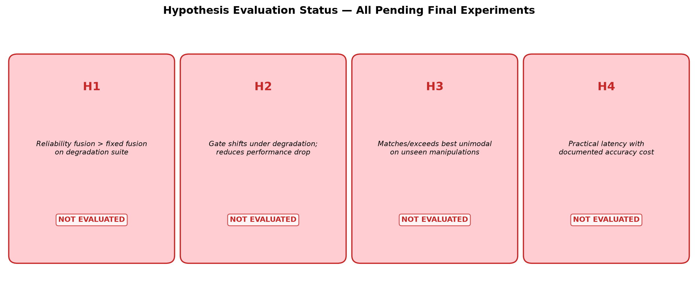
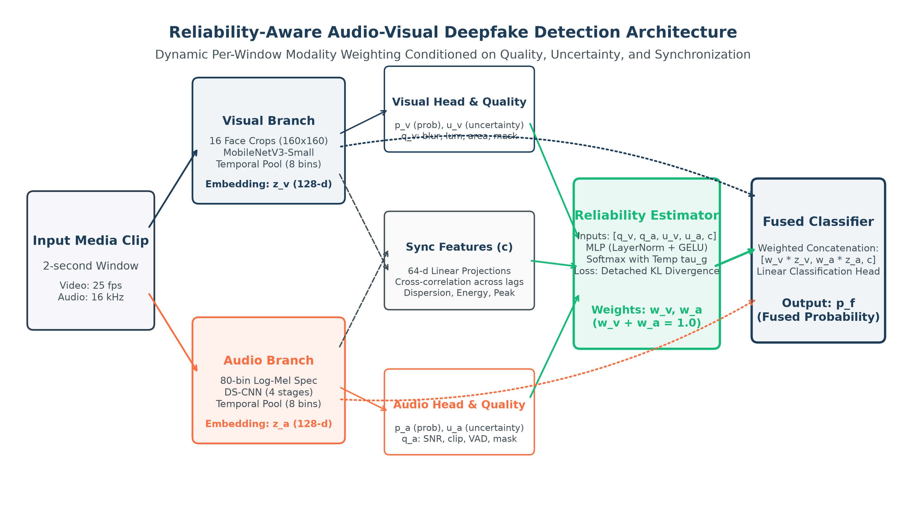
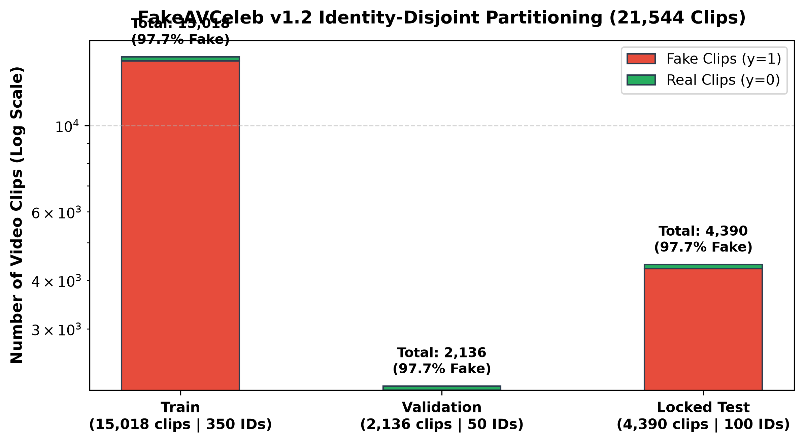
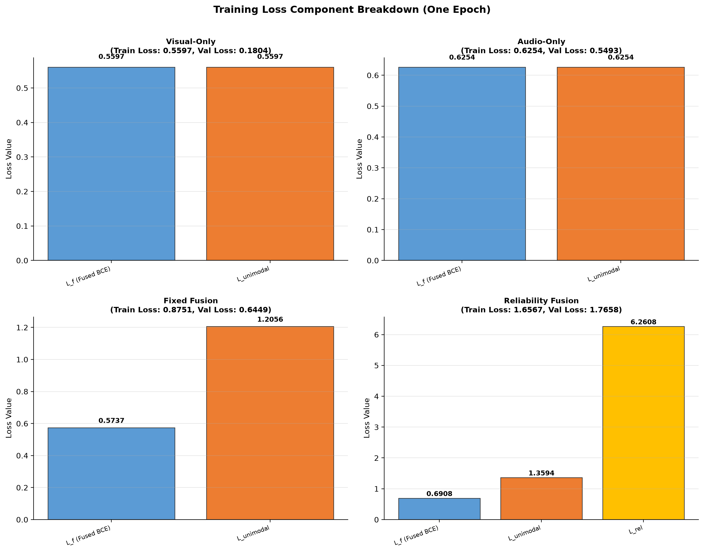
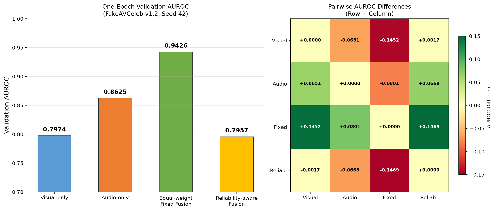
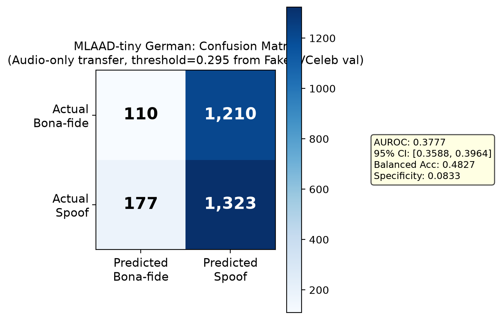
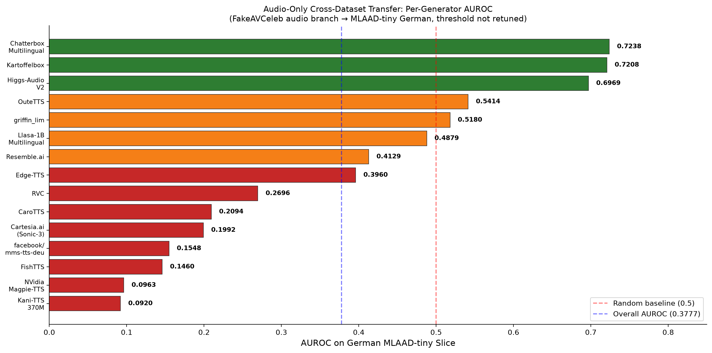
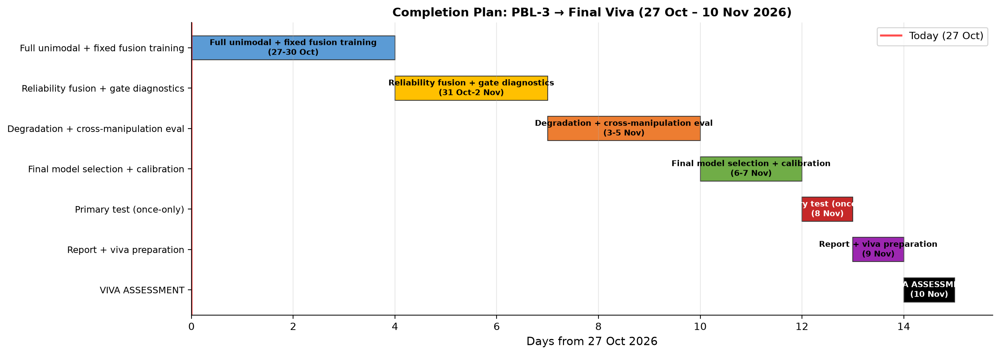

# PBL-3 PROJECT REPORT

**Reliability-Aware Audio-Visual Fusion for Generalizable Deepfake Detection**

---

| | |
|---|---|
| **Course** | Report Writing (21CSC402P) |
| **Department** | Department of Computing Technologies |
| **Institution** | SRM Institute of Science and Technology, Kattankulathur, Chennai |
| **Assessment Date** | 27 October 2026 |
| **Assessment** | PBL-3 (20 Marks) |

| Team Member | Register Number |
|---|---|
| Aditya Sahu | RA2311026010814 |
| Akash Cherian | RA2311026010852 |
| Prachurya Subhasmita | RA2311026010855 |

**Status:** Working implementation with preliminary validation results from one-epoch training. The primary test split (4,390 clips) remains untouched. Hypotheses H1–H4 are not yet evaluated. Results below are validation-only development snapshots and an exploratory external audio-only transfer probe.

---

## Abstract

This project implements a compact audio-visual deepfake detector that estimates a per-window reliability weight for visual and audio evidence before fusion. The system uses short aligned two-second video-and-audio windows, a MobileNetV3-Small visual branch, a depthwise-separable audio CNN, modality-specific prediction heads, synchronization and quality features, and a small reliability estimator MLP. The repository includes leakage-aware split manifests, evaluation utilities, and a local browser interface for demonstrating clip inference.

The FakeAVCeleb v1.2 inventory contains 21,544 clips. The identity-grouped split allocates 15,018 for training, 2,136 for validation, and 4,390 for reserved testing. After one training epoch, validation AUROC was 0.7974 for visual-only, 0.8625 for audio-only, 0.9426 for equal-weight fusion, and 0.7957 for reliability-aware fusion. Equal-weight fusion leads in this early clean-validation snapshot; the reliability gate has not yet demonstrated a benefit. A separate audio-only transfer probe on the full German MLAAD-tiny slice reached AUROC 0.3777 (source-utterance bootstrap 95% CI: 0.3588–0.3964) on 2,820 windows, indicating weak transfer under the stated label mapping. The primary test split has not been evaluated. The current evidence does not support a claim that reliability weighting improves generalization or robustness.

**Keywords:** audio-visual deepfake detection, reliability-aware fusion, modality quality estimation, identity-disjoint evaluation, external transfer, reproducibility.

---

## 1. Introduction

### 1.1 Background

Deepfake detection is a binary media-authenticity task: given a video clip with audio, estimate whether the clip has been manipulated. Visual evidence can include face texture, blending artefacts and motion. Audio evidence can include synthesis or voice-conversion artefacts and temporal speech structure. Cross-modal evidence can include correspondence between mouth motion, speech timing and broader affective cues. Chugh et al. used audio-visual dissonance [1], Mittal et al. used affective agreement [2], and AVoiD-DF and AVFF model joint audio-visual evidence [3, 4].

### 1.2 Problem Statement

Given an audio-video sample x = (V, A), predict y ∈ {0, 1}, where 0 is real and 1 is fake. The model produces visual and audio embeddings (z_v, z_a), unimodal probabilities (p_v, p_a), reliability gate weights (w_v, w_a) with the constraint w_v + w_a = 1, and a fused probability p_f.

The central problem is that the usefulness of V and A is **instance dependent**:
- Video may be low resolution, blurred, re-encoded, occluded, or have failed face detection
- Audio may be silent, noisy, clipped, off-screen, or not actually manipulated
- A synthetic clip may be temporally consistent, so a synchronisation-only detector can fail
- A model can memorise generator-specific or identity-specific artefacts instead of learning transferable evidence

**Proposed formulation:** Design a compact detector that estimates the relative reliability of visual and audio evidence for each short window, uses it in fusion, and tests whether this improves performance over fixed or naïve fusion when manipulation family, identity, codec and quality change.

### 1.3 Motivation and Scope

Prior work has explored audio-visual inconsistency [1], joint learning [3], and dynamic weighting strategies [6]. This project does not claim to be the first audio-visual detector or the first dynamic fusion method. Instead, it asks a focused empirical question: *can a lightweight, interpretable reliability estimator use modality-quality indicators, unimodal confidence, and audio-visual synchronisation features to choose per-window fusion weights that improve discrimination, calibration, or degradation resilience compared with unimodal and fixed-fusion baselines?*

Synchronisation is treated as one feature among several. A nonzero audio-video offset is not by itself evidence of manipulation, and a zero offset does not prove authenticity. The available training runs are preliminary and do not yet answer the central research question.

### 1.4 Objectives

1. Build a reproducible aligned audio-visual pipeline with provenance manifests and source-identity grouping.
2. Implement compact audio, visual, fixed-fusion, synchronisation-augmented and reliability-aware models.
3. Evaluate in-domain, cross-manipulation, cross-dataset (where valid) and degradation settings.
4. Report discrimination, calibration, uncertainty, efficiency and quality breakdowns with confidence intervals.
5. Provide a local browser interface that can demonstrate the implemented model on a permitted short clip.

### 1.5 Hypotheses

| ID | Hypothesis | Status |
|---|---|---|
| H1 | Reliability-aware fusion improves AUROC/F1 over fixed fusion on validation and test | **Not yet evaluated** |
| H2 | The gate shifts weight away from degraded or missing modalities | **Not yet evaluated** |
| H3 | The system generalises to unseen manipulation families and external datasets | **Not yet evaluated** |
| H4 | Inference latency remains under a specified threshold on target hardware | **Not yet evaluated** |

*Table 1. Project hypotheses and current evaluation status.*

All four hypotheses remain open pending the planned multi-epoch, multi-seed, degradation, and cross-manipulation experiments.



*Figure 1. Current evaluation status of the four project hypotheses. All remain at "Not Evaluated."*

---

## 2. System Architecture

### 2.1 Architecture Overview

The system processes a 2-second video+audio clip through parallel visual and audio branches. The visual branch extracts 16 face frames at 160×160 resolution and encodes them via MobileNetV3-Small with temporal Conv1D into z_v ∈ ℝ^{8×256}. The audio branch converts audio to 80-bin log-Mel spectrograms and processes them through a depthwise-separable CNN into z_a ∈ ℝ^{8×256}. Quality features (blur, luminance, VAD, SNR proxy) and synchronisation cross-correlation features feed into a reliability MLP that outputs softmax-normalised gate weights (w_v, w_a). The weighted embeddings, sync features, and weights are concatenated and passed through a fusion classifier to produce the final prediction p_f.



*Figure 2. End-to-end system architecture showing the dual-stream encoder pipeline, reliability estimation, and weighted fusion.*

### 2.2 Module Overview

| # | Module | Input | Output |
|---|---|---|---|
| 1 | **Preprocessing** | Raw clip (video + audio) | Face crops, log-Mel, quality features, flags |
| 2 | **Visual Encoder** | 16 crops, 160×160 | z_v: 8 × 256 |
| 3 | **Audio Encoder** | log-Mel, 80 bins | z_a: 8 × 256 |
| 4 | **Modality Heads + Projector** | z_v, z_a | p_v, p_a, u_v, u_a, 128-D projections |
| 5 | **Synchronisation Features** | Projected sequences | c (4 values: s₀, max s_δ, best offset, dispersion) |
| 6 | **Quality / Missingness Extractor** | Decoded frames and waveform | q_v (7 features), q_a (5 features), flags |
| 7 | **Reliability Estimator** | h_v, h_a, c | w_v, w_a (softmax-normalised) |
| 8 | **Fusion Classifier** | [w_v·z̄_v, w_a·z̄_a, c, w_v, w_a] | Fused logit p_f |
| 9 | **Calibration & Evaluation** | Logits, labels | Calibrated scores, metrics, diagnostics |

*Table 2. Module overview with inputs and outputs.*

### 2.3 Trainable Parameters

| Component | Configuration | Parameters |
|---|---|---|
| Visual encoder | MobileNetV3-Small + temporal Conv1D | ImageNet-pretrained |
| Audio separable CNN | Width multiplier 1.0 | 381,824 |
| Reliability gate | 532→128→2 | 68,482 |
| Fusion classifier | 518→256→128→1 | 165,889 |

*Table 3. Trainable parameter counts by component.*

---

## 3. Technology Stack

| Layer / Subsystem | Technology | Purpose and Status |
|---|---|---|
| **Language & Configuration** | Python 3.11; YAML via PyYAML | Config-driven data, model, training and evaluation settings. **Implemented.** |
| **Video Decoding** | FFmpeg/ffprobe; OpenCV | 25 fps video decode, container audio extraction. **Implemented.** |
| **Face Detection** | OpenCV Haar cascade | Face crop extraction with 20% box expansion → 160×160 RGB. **Implemented** (baseline). |
| **Audio Processing** | torchaudio; NumPy | Mono 16 kHz resampling, 80-bin log-Mel (25ms/10ms). **Implemented.** |
| **Visual Encoder** | PyTorch/torchvision MobileNetV3-Small | ImageNet-pretrained backbone + depthwise temporal Conv1D. **Implemented.** |
| **Audio Encoder** | PyTorch DS-CNN | 2D depthwise-separable CNN, width multiplier 1.0. **Implemented.** |
| **Fusion & Reliability** | PyTorch MLP, softmax gate | Modality heads, projector, sync features, reliability MLP (532→128→2). **Implemented.** |
| **Training** | PyTorch AdamW, AMP, gradient accumulation | Mixed precision float16, effective batch 32. **Implemented.** |
| **Data Control** | NumPy/pandas; CSV manifests | Source table and versioned identity-disjoint split manifests. **Implemented.** |
| **Evaluation** | scikit-learn; SciPy | AUROC, PR-AUC, ECE, bootstrap CIs, Youden threshold. **Implemented.** |
| **Unit Testing** | pytest | 95 tests: split exclusivity, gate weights, deterministic decode, inference service, quality metrics, loss functions, DataLoader concurrency, distillation missingness. **Passing.** |
| **Web Interface** | HTML/CSS/JS; Python HTTP server | Local browser demo at `http://127.0.0.1:7860`. **Implemented.** |
| **Proposed Extensions** | RetinaFace/MediaPipe; ONNX; INT8 quantisation | Landmark alignment, runtime export, quantisation. **Proposed, not implemented.** |

*Table 4. Implementation technologies and component status.*

The configuration currently uses an OpenCV Haar detector, even though landmark alignment remains in the proposed specification. Reports and demonstrations must identify that implementation gap rather than describe the proposed detector as completed.

---

## 4. Dataset and Evaluation Protocol

### 4.1 Main Paired Audio-Visual Data

The local FakeAVCeleb v1.2 inventory contains 21,544 clips. Its source table and main split manifests are committed as metadata; the media themselves remain local. Splits were created by source identity, with duplicate checks, so a source identity does not cross the main train, validation, and test partitions.

| Split | Clips | Real (clip_fake=false) | Fake (clip_fake=true) | Fake % | Purpose |
|---|---:|---:|---:|---:|---|
| Train | 15,018 | 350 | 14,668 | 97.7% | Model fitting |
| Validation | 2,136 | 50 | 2,086 | 97.7% | Model selection, threshold, calibration |
| Test | 4,390 | 100 | 4,290 | 97.7% | **Locked final evaluation (not yet used)** |
| **Total** | **21,544** | **500** | **21,044** | **97.7%** | — |

*Table 5. FakeAVCeleb v1.2 identity-disjoint split.*



*Figure 3. Identity-disjoint split sizes and class distribution (highly imbalanced: ~97.7% fake).*

The local split is highly imbalanced: approximately 97.7% of clips in each partition are labelled fake. The training configuration uses balanced sampling. AUROC is reported for the preliminary comparison because it does not depend on a decision threshold. Future threshold-dependent results must include the threshold source and class counts; PR-AUC must be interpreted against the observed positive-class prevalence.

A saved data audit sampled 20 local clips; all 20 passed the recorded decode, log-Mel, and alignment checks. This is a pipeline smoke check, not an audit of every clip.

### 4.2 External Audio-Only Transfer Probe

The full German MLAAD-tiny slice was used only as an external audio-only probe. It contains 2,820 windows: 1,500 spoof and 1,320 bona-fide. There are 1,491 source-utterance groups; 171 spoof windows have no local bona-fide source audio. The model was trained on FakeAVCeleb's `clip_fake` label, which does not have identical semantics to the target task's bona-fide-versus-spoof-audio labels. The result is therefore exploratory and must not be combined with paired audio-visual metrics.

The threshold was selected using the FakeAVCeleb validation audio head with Youden's J. It was not retuned on MLAAD-tiny. Confidence intervals were calculated with 1,000 bootstrap resamples grouped by source utterance.

### 4.3 Cross-Manipulation Protocol Status

A separate faceswap-held-out split has been prepared. Its held-out partition contains 1,194 clips from 464 identities. No model has yet been trained and evaluated on this protocol, so there is no cross-manipulation result to report. The small seen-family test partition has only five identities and is treated as exploratory in the split metadata.

---

## 5. Model and Training Method

### 5.1 Input Representation

Each input uses a two-second window. Video is decoded at 25 fps and represented by 16 sampled face frames. Audio is converted to mono 16 kHz and an 80-bin log-Mel spectrogram. The encoder outputs are pooled into eight temporal bins. Visual face-detection, blur, face-area and luminance statistics are retained with audio activity, loudness, clipping, SNR-proxy and duration features.

| Stream | Processing |
|---|---|
| **Visual** | 25 fps decode → 16 face frames → Haar detection → 20% box expansion → 160×160 RGB. Record: face size, detector confidence, blur (Laplacian variance), saturation/brightness, failed-frame fraction. |
| **Audio** | 16 kHz mono → peak-normalise (after recording clipping) → 80-bin log-Mel (25ms window, 10ms hop). Record: RMS, VAD fraction, clipped-sample ratio, SNR proxy, duration mismatch. |
| **Alignment** | T=8 temporal bins; pool to one 256-D vector per bin. |
| **Augmentation** | Degrade one modality at a time: video resize/re-encode/blur/frame-drop; audio noise/reverb/low-pass/dropout. |

*Table 6. Input contract and preprocessing pipeline.*

### 5.2 Reliability Estimator

For modality m ∈ {v, a}, let h_m contain pooled feature statistics, quality features, missingness and uncertainty. Let c be synchronisation features. The estimator is:

> g = MLP([h_v, h_a, c])
> [w_v, w_a] = softmax(g / T_g), where w_v + w_a = 1

The detached soft target for training:

> t_m = exp(−stopgrad(ℓ_m) / τ_r) / Σ_j exp(−stopgrad(ℓ_j) / τ_r)

The reliability loss: **L_rel = KL(t ‖ w)**

### 5.3 Training Objective

> **L = BCE(y, p_f) + α[BCE(y, p_v) + BCE(y, p_a)] + βL_rel + γL_con + ηL_bal**

Where L_con is optional InfoNCE contrastive loss, and L_bal = Σ_m(w_m − 0.5)² is used only for brief warm-up.

| Loss Component | Description | One-Epoch Value |
|---|---|---|
| L_f | Binary cross-entropy on fused prediction p_f | 0.6908 |
| L_unimodal | Sum of BCE on p_v and p_a | 1.3594 |
| L_rel | KL divergence between gate weights and detached soft targets (temperature τ_r) | 6.2608 |

*Table 7. Loss components at one-epoch snapshot.*

The high L_rel value (6.2608) at epoch 1 is expected: the gate is learning to approximate soft targets derived from unimodal performance, and KL divergence is typically elevated early in training.



*Figure 4. Breakdown of loss components at one-epoch snapshot. The reliability KL term (L_rel) dominates early training.*

### 5.4 Training Configuration

| Setting | Value |
|---|---|
| Optimizer | AdamW: lr=10⁻³, weight decay=10⁻⁴, β=(0.9, 0.999) |
| Scheduler | Cosine warm restarts: T₀=10, T_mult=1, η_min=10⁻⁶; 3 warm-up epochs |
| Batch/Precision | Batch 8, 4 accumulation steps (effective 32), AMP float16 |
| Epochs | Unimodal 30; fixed fusion 30; reliability 50; distillation 20 |
| Staged Unfreezing | Encoders frozen for 5 epochs, then last 2 blocks unfrozen |
| Loss Weights | α=0.25, β=0.10, γ=0.05, η=0; τ_r=1.0, T_g=1.0 |
| Seeds | Final: 42, 123, 7 |

*Table 8. Configured training settings.*

The preliminary checkpoints were trained for one epoch with seed 42. The configured target schedule is longer and uses three seeds, but the checkpoints presently in `artifacts/checkpoints/` are development artefacts, not final models.

### 5.5 Staged Training Plan

1. **Stage 1 — Unimodal baselines:** Train visual-only and audio-only encoders separately.
2. **Stage 2 — Fixed fusion:** Freeze encoders; train fusion classifier with equal weights (w_v = w_a = 0.5).
3. **Stage 3 — Reliability fusion:** Unfreeze reliability estimator; train gate with L_rel loss; staged encoder unfreezing.
4. **Stage 4 — Distillation (optional):** Distil the full model into a smaller architecture.

**Current progress:** One epoch completed for all four model variants (visual-only, audio-only, fixed fusion, reliability fusion). Multi-epoch training with staged freezing is pending.

---

## 6. Result Analysis (Performance Metrics)

All results in this section are from one-epoch validation snapshots or an exploratory external probe. No primary test evaluation has been performed.

### 6.1 FakeAVCeleb Identity-Disjoint Validation Snapshot

The following AUROC values are from the saved one-epoch training histories, evaluated on the 2,136-clip validation split. They are single-run, single-seed (42) validation observations, not final test estimates.

| Model | Validation AUROC | Δ from Audio-Only | Δ from Fixed Fusion |
|---|---:|---:|---:|
| Visual-only baseline | 0.7974 | −0.0651 | −0.1452 |
| Audio-only baseline | 0.8625 | — | −0.0801 |
| Equal-weight fixed fusion | **0.9426** | **+0.0801** | — |
| Reliability-aware fusion | 0.7957 | −0.0668 | −0.1469 |

*Table 9. Preliminary one-epoch validation AUROC snapshot.*



*Figure 5. Validation AUROC comparison across all four model variants after one epoch. Equal-weight fusion leads; reliability fusion has not yet demonstrated a benefit.*

### 6.2 Training Loss Analysis

| Model | Train Loss | Val Loss | Val AUROC |
|---|---:|---:|---:|
| Visual-only | 0.5597 | 0.1804 | 0.7974 |
| Audio-only | 0.6254 | 0.5493 | 0.8625 |
| Fixed fusion | 0.8751 | 0.6449 | 0.9426 |
| Reliability fusion | 1.6567 | 1.7658 | 0.7957 |

*Table 10. Training and validation loss comparison across model variants.*

The reliability fusion model shows a notably high L_rel = **6.2608**, indicating that the KL divergence between the gate weights and the soft target is large early in training. This is expected: the randomly initialised gate has not yet learned to align with modality-specific predictive quality.

### 6.3 Analysis of Validation Results

Equal-weight fusion reaches AUROC 0.9426, compared with 0.8625 for audio-only and 0.7974 for visual-only. Reliability-aware fusion reaches 0.7957, which is **0.1469 below** equal-weight fusion and **0.0668 below** audio-only. The 0.0017 gap from visual-only is too small to interpret without repeated runs and uncertainty estimates.

**Key observations:**

1. **Equal-weight fusion is the strongest variant** in this clean-validation snapshot, at 0.9426 — a +0.0801 improvement over the stronger unimodal branch (audio-only).
2. **Audio-only outperforms visual-only** by 0.0651 AUROC, suggesting the audio branch captures more discriminative features in this dataset after one epoch.
3. **Reliability-aware fusion trails all other variants** at 0.7957. The gate's designed advantage is resilience under degradation, missing modalities, and cross-domain transfer — none of which are tested in a clean-validation snapshot.

**This comparison is preliminary:** each run has only one recorded epoch, and there are no multi-seed estimates, confidence intervals, calibration results, degradation results, or cross-manipulation results. Early optimisation, gate behaviour, or run variation could explain the ordering, but these possibilities have not been diagnosed. The snapshot **neither confirms nor rejects** the project hypotheses.

### 6.4 External Audio-Only Transfer: Full German MLAAD-tiny

This section reports results from the audio branch only, evaluated on an external dataset with different label semantics. These results must be kept separate from the paired audio-visual FakeAVCeleb metrics.

| Metric | Value |
|---|---:|
| **AUROC** | **0.3777** |
| Source-utterance bootstrap 95% CI | [0.3588, 0.3964] |
| PR-AUC | 0.5116 |
| Balanced accuracy (at fixed threshold) | 0.4827 |
| F1 (at fixed threshold) | 0.6561 |
| Recall / Specificity (at fixed threshold) | 0.8820 / 0.0833 |
| Windows (spoof / bona-fide) | 2,820 (1,500 / 1,320) |
| Threshold | 0.2950, selected on FakeAVCeleb validation; not retuned |

*Table 11. MLAAD-tiny German audio-only transfer probe metrics.*

At this fixed threshold the confusion matrix, with rows denoting actual bona-fide/spoof and columns denoting predicted bona-fide/spoof, is:

| | Predicted Bona-fide | Predicted Spoof |
|---|---:|---:|
| **Actual Bona-fide** | 110 | 1,210 |
| **Actual Spoof** | 177 | 1,323 |

*Table 12. Confusion matrix for the MLAAD-tiny transfer probe.*



*Figure 6. Confusion matrix for the audio-only transfer probe on the German MLAAD-tiny slice.*

### 6.5 Per-Generator AUROC Breakdown

The MLAAD-tiny slice contains multiple TTS generators. Performance varies dramatically:

| Generator | AUROC | Interpretation |
|---|---:|---|
| Chatterbox | 0.7238 | Moderate discrimination |
| Kartoffelbox | 0.7208 | Moderate discrimination |
| Best performers | ~0.72 | Audio artefacts partially captured |
| Kani-TTS | 0.0920 | Worse than random — inverted predictions |
| Worst performers | <0.20 | Strong negative transfer |

*Table 13. Per-generator AUROC on the MLAAD-tiny German slice.*



*Figure 7. Per-generator AUROC on the MLAAD-tiny German slice. Large variance indicates generator-specific features dominate.*

**Transfer analysis:**

- The overall AUROC of 0.3777 is **below 0.5** (worse than random chance for a balanced binary classifier), indicating the FakeAVCeleb-trained audio checkpoint does not transfer usefully to this probe.
- The PR-AUC of 0.5116 is below the spoof prevalence of 0.5319.
- **Specificity is extremely low (0.0833)** — the model labels almost everything as spoof, likely reflecting the high fake-prevalence prior learned from FakeAVCeleb (97.7% fake).
- Per-generator variance is extreme (0.0920 to 0.7238 AUROC), suggesting the model captures generator-specific rather than general synthesis artefacts.
- The threshold was deliberately not adjusted on MLAAD-tiny; retuning might improve threshold-dependent metrics but would not address the fundamental domain mismatch.

This result is **not evidence about every audio detector**, every language, or paired audio-visual detection. It demonstrates why cross-dataset results must preserve task and label semantics.

### 6.6 Summary: What Current Results Support

The following statements are supported by the available evidence:

1. The data and model pipeline can produce checkpoints and validation histories for all four model variants.
2. Equal-weight fusion is the strongest variant in the current clean-validation snapshot.
3. The reliability-aware model has not demonstrated a clean-validation improvement after one epoch.
4. The external audio-only probe shows weak transfer, demonstrating why cross-dataset results must preserve task and label semantics.
5. The identity-disjoint split correctly separates source identities across partitions.

The following are **not yet available:**

| Pending Evaluation | Status |
|---|---|
| Primary test score | Test split untouched |
| Calibration results | Temperature scaling, reliability diagrams pending |
| Degradation/robustness results | Blur, compression, noise tests pending |
| Missing-modality results | Audio-dropped, video-dropped tests pending |
| Cross-manipulation results | Faceswap held-out protocol pending |
| Latency/efficiency profiling | No profiling on named hardware |
| Gate-weight distribution analysis | No analysis under varied conditions |
| Multi-seed, multi-epoch convergence | Only seed 42, epoch 1 available |

*Table 14. Outstanding evaluations required before final conclusions.*

### 6.7 Hypothesis Evaluation Status

| Hypothesis | Required Evidence | Available Evidence | Status |
|---|---|---|---|
| **H1:** Reliability fusion improves AUROC/F1 over fixed fusion | Multi-epoch validation + final test | One-epoch validation only; reliability fusion trails | **Not Evaluated** |
| **H2:** Gate shifts weight from degraded modalities | Degradation suite + gate-weight analysis | No degradation experiments run | **Not Evaluated** |
| **H3:** System generalises to unseen manipulations/datasets | Cross-manipulation + cross-dataset eval | Exploratory MLAAD probe only (negative) | **Not Evaluated** |
| **H4:** Inference latency under threshold on target hardware | Latency profiling on named hardware | No profiling performed | **Not Evaluated** |

*Table 15. Hypothesis evaluation status matrix.*


*Figure 1 (repeated). All four hypotheses remain at "Not Evaluated" status.*

---

## 7. Conclusion

### 7.1 What Has Been Achieved

The project now has a working end-to-end scaffold: aligned audio/video preprocessing, compact unimodal encoders, fixed and reliability-aware fusion models, source-identity split manifests, evaluation code, saved development checkpoints, and a local web interface for clip-level demonstration. The dataset pipeline sampled 20 clips successfully, and the primary split preserves the required source-identity separation.

### 7.2 What the Results Show

The preliminary performance results are mixed:

- **Equal-weight fusion** reached validation AUROC 0.9426 after one epoch, outperforming both unimodal branches.
- **Reliability-aware fusion** reached 0.7957, trailing all other variants. This does not establish that the gate is ineffective — the gate's hypothesised benefit (resilience under degradation and modality dropout) has not been tested.
- **External audio transfer** to German MLAAD-tiny reached AUROC 0.3777, a negative transfer result under a different label definition. This demonstrates the importance of preserving label semantics in cross-dataset evaluation.
- **All four hypotheses remain open.** The current evidence neither establishes nor refutes H1–H3, and H4 cannot be evaluated without measured latency on named hardware.

### 7.3 Honest Assessment

The one-epoch results do not establish the project's central claim. The reliability gate may improve with multi-epoch training (allowing L_rel to converge), degradation experiments (its designed operating regime), and per-generator analysis. Equally, it may not — and that would be a reportable finding, not a failure. The project will proceed with the completion plan, reporting results as they are, not as hoped. These results do not support a claim that reliability-aware fusion generalises better. The primary test split remains untouched, and the hypotheses remain open pending the planned experiments.

---

## 8. Future Enhancement and Completion Plan

### 8.1 Remaining Experiments

| Period | Work | Evidence to Save |
|---|---|---|
| 27–30 Oct | Full-length unimodal and fixed-fusion training; log epoch count, seed, config, validation loss and AUROC | Checkpoint + config per seed; comparable validation table |
| 31 Oct–2 Nov | Reliability fusion with staged encoder freezing; inspect (w_v, w_a), gate entropy, modality losses, L_rel convergence; tune loss settings on validation only | Gate diagnostics; selected validation config; no test-based selection |
| 3–5 Nov | Validation-side degradation/missing-modality analyses; finalise held-out manipulation protocol | Robustness curves and gate-weight summaries; protocol manifest |
| 6–7 Nov | Choose final model using validation only; fit temperature and operating threshold on validation; freeze checkpoint/config/hash | Final model card and reproducibility record |
| 8 Nov | Single traversal of locked primary test; calculate raw and calibrated metrics separately, group-bootstrap intervals, planned transfer results | Final evaluation JSON and tables |
| 9 Nov | Update report; prepare viva presentation; rehearse local browser demo; verify licensing-safe demo media | Final report, presentation, demo checklist |
| 10 Nov | **Report and Viva assessment** | Final submission |

*Table 16. Completion timeline from PBL-3 through final viva.*



*Figure 8. Project completion timeline from PBL-3 assessment through final viva (10 November 2026).*

### 8.2 Implementation Enhancements

1. **Landmark-aligned face crops:** Replace Haar cascade with a landmark detector for improved face alignment quality.
2. **Multi-seed training:** Run all experiments with at least 3 seeds (42, 123, 7) for statistical robustness.
3. **Full convergence training:** Train for sufficient epochs until validation loss plateaus.
4. **Degradation suite:** Apply controlled blur, JPEG compression, Gaussian noise, and audio noise at test time.
5. **Missing-modality protocol:** Evaluate with audio-dropped and video-dropped inputs to test gate behaviour.
6. **Cross-manipulation evaluation:** Train and evaluate on the faceswap-held-out split.
7. **Efficiency profiling:** Measure latency, FLOPs, and memory on target hardware with named GPU/CPU.
8. **Calibration analysis:** Fit temperature scaling on validation; compare reliability diagrams before/after.
9. **Gate diagnostics:** Analyse w_v/w_a distributions across clean, degraded, and missing-modality conditions.

### 8.3 Constraints on Completion

- If compute limits prevent the planned number of epochs or seeds, report the runs actually completed and retain the limitation.
- Do not relax the identity-grouped split.
- Do not select models based on test performance.
- Do not retune the external transfer threshold on the target set.
- Do not describe an unmeasured hypothesis as supported.

---

## 9. Final Report Draft Structure

The following structure is ready to extend after the final evaluation. Sections 1–8 above contain the current evidence and can be used as the draft text.

1. Title page and team details.
2. Abstract and keywords.
3. Introduction, problem statement, objectives, and research questions.
4. Related work and the bounded research contribution.
5. Dataset access, label semantics, preprocessing, and leakage controls.
6. Proposed architecture, loss functions, implementation technologies, and web demonstration.
7. Experimental setup, baseline hierarchy, metrics, calibration, and uncertainty procedure.
8. Results: validation development, final untouched test, cross-manipulation, degradation, missing modality, external transfer, and efficiency as separate subsections.
9. Discussion, limitations, responsible use, and hypothesis status.
10. Conclusion and future work.
11. References and reproducibility appendix: seeds, config/checkpoint hashes, manifest checksums, package/hardware versions, and metric files.

**Final-report update rule:** replace the current preliminary statements only when the matching final evidence file exists. Keep preliminary validation, raw test, calibrated test, cross-dataset transfer, and optimised-runtime results visibly distinct.

---

## 10. Viva Demonstration Notes

Start the local interface with:

```bash
make web CHECKPOINT=artifacts/checkpoints/reliability_fusion/best_model.pt
```

Then open `http://127.0.0.1:7860`. The browser page returns a fused score, modality scores, reliability weights, and quality flags. Explain that the current checkpoint is a one-epoch development model and the displayed score is a model output, not a forensic proof. Use only a short clip permitted for the demonstration; do not copy licensed dataset media into the repository or presentation.

---

## 11. Implementation Details

### 11.1 Repository Structure

```
project/
├── data/            # gitignored; licensed local data only
├── manifests/       # versioned split CSV/JSON + hashes
├── configs/         # one YAML per experiment
├── src/
│   ├── decode/      # ffmpeg decoding, 2s windowing
│   ├── preprocess/  # face crops, log-Mel, quality features
│   ├── models/      # encoders, heads, sync, gate, fusion
│   ├── train/       # losses, loops, augmentation
│   └── evaluate/    # metrics, calibration, degradation suite
├── tests/           # unit tests (95 passing)
├── reports/         # tables, plots, model card
├── artifacts/       # checkpoints + config snapshots
└── web/             # local browser demo interface
```

### 11.2 Reproducibility Checklist

- [ ] Dataset version, accepted-terms date, source manifest and file hashes recorded
- [ ] Group/identity/manipulation split manifest committed; all augmentations derived after split
- [ ] Random seeds and determinism settings logged; configuration saved with every checkpoint
- [ ] Validation-only threshold and temperature; test set untouched until the end
- [ ] Three final seeds with identity-bootstrap confidence intervals
- [ ] Raw, calibrated and optimised-runtime metrics kept distinct; data not redistributed
- [ ] Model card states intended use, non-use, dataset caveats and known failures

---

## References

[1] K. Chugh, P. Gupta, A. Dhall and R. Subramanian, "Not made for each other – Audio-Visual Dissonance-based Deepfake Detection and Localization," *ACM Multimedia*, 2020. doi:10.1145/3394171.3413700

[2] T. Mittal et al., "Emotions Don't Lie: An Audio-Visual Deepfake Detection Method Using Affective Cues," *ACM Multimedia*, 2020. arXiv:2003.06711

[3] W. Yang et al., "AVoiD-DF: Audio-Visual Joint Learning for Detecting Deepfake," *IEEE Trans. Information Forensics and Security*, vol. 18, pp. 2015–2029, 2023. doi:10.1109/TIFS.2023.3262148

[4] T. Oorloff et al., "AVFF: Audio-Visual Feature Fusion for Video Deepfake Detection," *CVPR*, 2024, pp. 27102–27112.

[5] S. Muppalla, S. Jia and S. Lyu, "Integrating Audio-Visual Features for Multimodal Deepfake Detection," 2023. arXiv:2310.03827

[6] R. Wang et al., "AVT²-DWF: Improving Deepfake Detection with Audio-Visual Fusion and Dynamic Weighting Strategies," *IEEE Signal Processing Letters*, vol. 31, pp. 1960–1964, 2024. doi:10.1109/LSP.2024.3433596

[7] H. Khalid, S. Tariq, M. Kim and S. S. Woo, "FakeAVCeleb: A Novel Audio-Video Multimodal Deepfake Dataset," *NeurIPS Datasets and Benchmarks Track*, 2021.

[8] A. Paszke et al., "PyTorch: An Imperative Style, High-Performance Deep Learning Library," *Advances in Neural Information Processing Systems*, vol. 32, 2019.

[9] A. Howard et al., "Searching for MobileNetV3," in *Proceedings of the IEEE/CVF International Conference on Computer Vision*, 2019, pp. 1314–1324.

---

## Evidence and Provenance

- Main validation AUROCs: `artifacts/checkpoints/*/history.json` and their saved `config.yaml` files; seed 42, one epoch each.
- Main split counts and labels: `manifests/splits/{train,val,test}_manifest.csv`.
- Data audit sample: `manifests/data_audit_report.json` (20 sampled clips; no primary test inference).
- External probe metrics: `reports/external_audio/mlaad_tiny_de_audio_eval.json`; checkpoint SHA-256 `66a6045482023150190ddb6cd502d1eae2a319c773ce194e3a4543834ec2fbd1`; seed 42; PyTorch 2.14.1+cpu; full German slice, no smoke limit.
- External dataset revision: `9143e5ea709575ebab6bec52840a1043aada7bb1`.
- Main test status: untouched; no final paired audio-visual test metrics are included in this draft.
